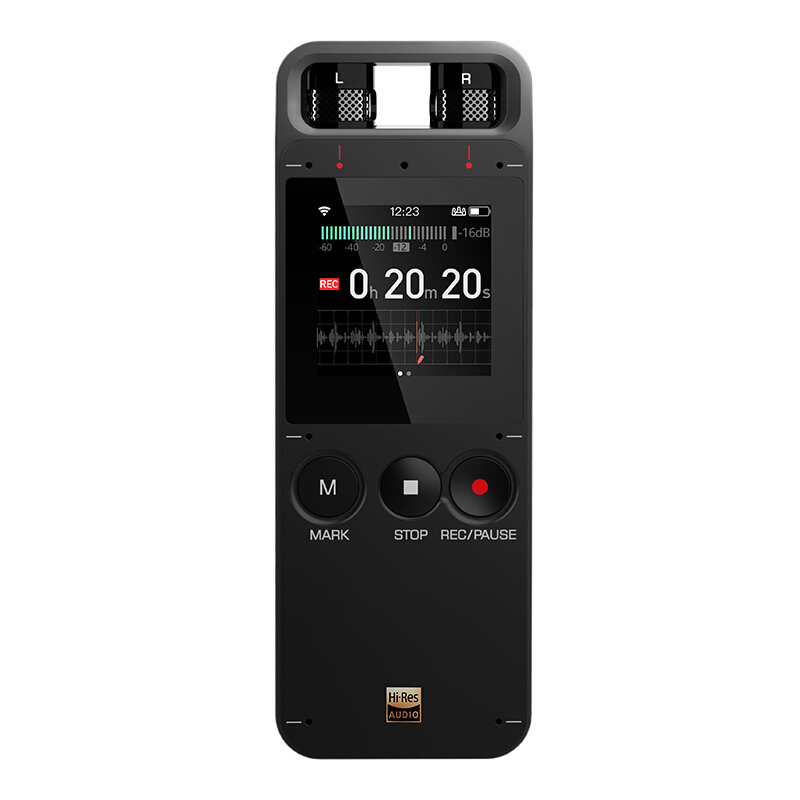

# Sogou E1 on AOSP 8.1

[简体中文](README.zh-CN.md)

## Hardware

<table>
  <tr>
    <td valign="middle"></td>
    <td valign="top">
      <table>
        <thead>
          <tr><th>Item</th><th>Specification</th></tr>
        </thead>
        <tbody>
          <tr><td>SoC</td><td>Rockchip RK3308B, four Cortex-A35 cores, 1.3 GHz, 1.6 GHz boost</td></tr>
          <tr><td>Memory</td><td>512 MiB RAM + 128 MiB zram</td></tr>
          <tr><td>Display</td><td>320 × 320</td></tr>
          <tr><td>Audio</td><td>RK3308 analog codec, AC107 ADC and RK3308 PDM capture interface</td></tr>
          <tr><td>Wireless</td><td>RTL8723DS Wi-Fi and Bluetooth</td></tr>
          <tr><td>OS</td><td>AOSP <code>android-8.1.0_r81</code>, <code>arm32_binder64</code></td></tr>
        </tbody>
      </table>
    </td>
  </tr>
</table>

## Status

- Verified desktop boot, recovery ADB, backlight control and USB scrcpy (320 × 320 H.264).
- Tested with Mesa 25.0.7 llvmpipe.
- Audio and wireless integration are pending.

## Performance

| Metric | Measured |
| --- | --- |
| CPU | 1.608 GHz, 98% utilization |
| Memory | 277 MB, 46% |
| FPS | 30–40 FPS |

## Build instructions

To be determined.
