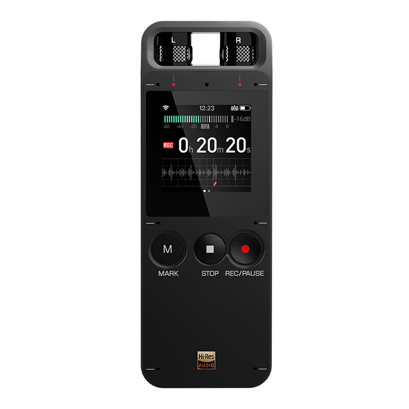

# 搜狗 E1  AOSP 8.1

[English](README.md)

## 硬件

<table>
  <tr>
    <td valign="middle"></td>
    <td valign="top">
      <table>
        <thead>
          <tr><th>项目</th><th>规格</th></tr>
        </thead>
        <tbody>
          <tr><td>SoC</td><td>Rockchip RK3308B，四核 Cortex-A35，1.3 GHz，Boost 1.6 GHz</td></tr>
          <tr><td>内存</td><td>512 MiB RAM + 128 MiB zram</td></tr>
          <tr><td>屏幕</td><td>320 × 320</td></tr>
          <tr><td>音频</td><td>RK3308 模拟编解码器、AC107 ADC 和 RK3308 PDM 采集接口</td></tr>
          <tr><td>无线</td><td>RTL8723DS Wi-Fi 和蓝牙</td></tr>
          <tr><td>OS</td><td>AOSP <code>android-8.1.0_r81</code>，<code>arm32_binder64</code></td></tr>
        </tbody>
      </table>
    </td>
  </tr>
</table>

## 适配状态

- 已验证桌面启动、Recovery ADB、背光调节和 USB scrcpy（320 × 320 H.264）。
- 实测 Mesa 25.0.7 llvmpipe。
- 待完成音频和无线适配

## 性能

| 指标 | 实测 |
| --- | --- |
| CPU | 1.608 GHz，98% |
| 内存 | 277 MB，46% |
| FPS | 30–40 FPS |

## 构建说明

待定。
